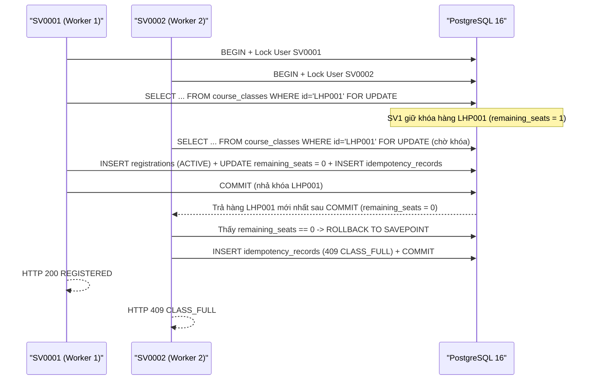
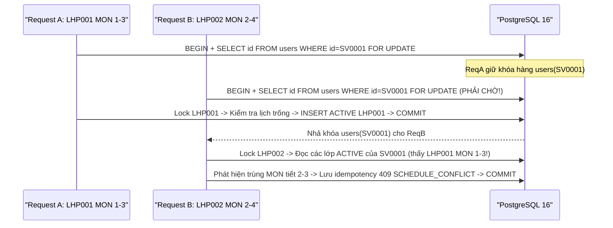
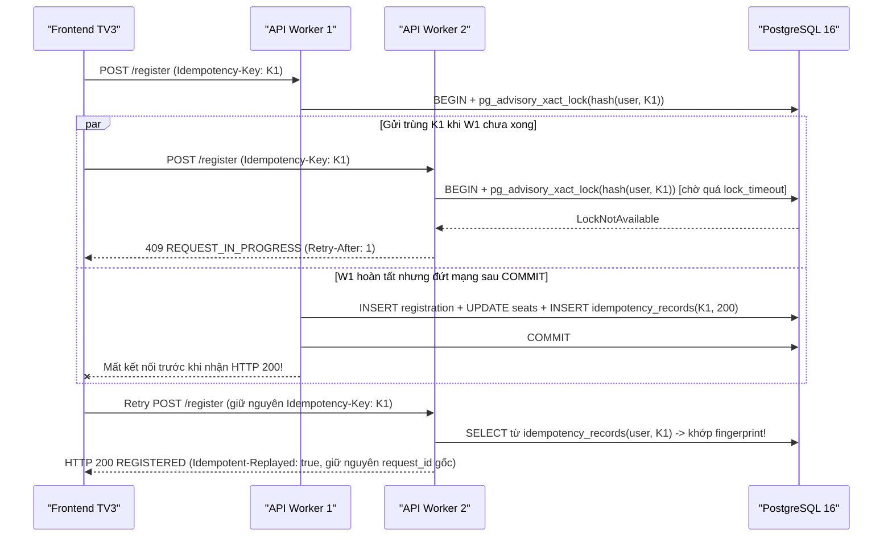

# Thiết kế Xử lý Đồng thời, Khóa Giao dịch & Idempotency (`concurrency_design.md`)

Tài liệu này giải thích cơ chế kiểm soát đồng thời trên PostgreSQL 16, lý do thứ tự khóa, thiết kế Idempotency xuyên nhiều worker và trả lời trực tiếp các câu hỏi phản biện bảo vệ đồ án.

---

## 1. Mức Cô lập Giao dịch & Thứ tự Khóa Chuẩn

- **Mức cô lập**: PostgreSQL `READ COMMITTED` kết hợp khóa hàng tường minh `SELECT ... FOR UPDATE` và khóa tư vấn cấp giao dịch `pg_advisory_xact_lock`.
  - *Vì sao chọn `READ COMMITTED` + `FOR UPDATE` thay vì `SERIALIZABLE` mặc định cho mọi truy vấn?*
    Trong bài toán 100–3.000 sinh viên cùng tranh chỗ trên 1 hàng `course_classes`, mức `SERIALIZABLE` tạo ra hàng loạt lỗi `40001 SerializationFailure` buộc ứng dụng phải vòng lặp retry tốn kết nối. Ngược lại, `READ COMMITTED` kết hợp `SELECT ... FOR UPDATE` xếp hàng (queue) các giao dịch ngay tại hàng dữ liệu bị tranh chấp trong nhân PostgreSQL: khi giao dịch trước `COMMIT`, giao dịch kế tiếp đọc ngay giá trị `remaining_seats` mới nhất sau khóa mà không cần abort.
- **Thứ tự khóa bất biến xuyên toàn hệ thống**:
  - **Luồng Sinh viên (`register`, `cancel`, `payment`)**:
    `pg_advisory_xact_lock(user_id, idempotency_key)` → `users (FOR UPDATE)` → `course_classes (FOR UPDATE)` → `registrations (FOR UPDATE)` → `payments (FOR UPDATE)`.
  - **Luồng Quản trị (`PUT / PATCH course-classes`)**:
    Chỉ khóa `course_classes (FOR UPDATE)` và **không bao giờ** khóa `users` sau đó.
  - Nhờ thứ tự khóa một chiều nghiêm ngặt này, hai luồng sinh viên – sinh viên (như thanh toán và hủy đồng thời TC24) hoặc quản trị – sinh viên không thể tạo chu trình chờ khóa (deadlock).

---

## 2. Sơ đồ Trình tự các Tình huống Tranh chấp Cốt lõi

### 2.1. Tranh 1 chỗ cuối bởi nhiều sinh viên (TC06)

### 2.2. Cùng sinh viên đăng ký đồng thời 2 lớp khác nhau nhưng trùng lịch (TC23)

### 2.3. Idempotency: Request mới, Cùng key đồng thời & Mất phản hồi sau COMMIT (TC11 & TC25)

---

## 3. Giải thích Kỹ thuật để Bảo vệ Đồ án (10 Câu hỏi Trọng tâm)

### Câu 1: Race condition xảy ra thế nào nếu kiểm chỗ (`SELECT`) và ghi (`INSERT/UPDATE`) tách rời?
Nếu ứng dụng chạy `SELECT remaining_seats` trước mà không khóa, 20 request đến cùng lúc đều đọc thấy `remaining_seats = 1`, cả 20 đều vượt qua câu lệnh `if remaining_seats > 0:` trong Python và cùng ghi 20 đăng ký vào lớp chỉ còn 1 chỗ (overselling).

### Câu 2: `SELECT ... FOR UPDATE`, partial unique `ACTIVE` và transaction giải quyết phần nào?
- `SELECT ... FOR UPDATE` tuần tự hóa việc đọc – kiểm tra – trừ chỗ trên hàng `course_classes` và tuần tự hóa thao tác của từng sinh viên trên hàng `users`.
- Partial unique index `uq_registrations_active_user_class` là chốt chặn vật lý ở tầng lưu trữ ngăn trùng đăng ký `ACTIVE` ngay cả khi có lỗi logic tầng trên.
- Transaction bảo đảm tính nguyên tử (All-or-Nothing): nếu `INSERT registrations` thành công nhưng bước giảm `remaining_seats` hoặc lưu `idempotency_records` gặp lỗi (TC10), toàn bộ thay đổi được `ROLLBACK`, không bao giờ mất chỗ ngồi vô hình.

### Câu 3: Vì sao chỉ khóa lớp (`course_classes`) là chưa đủ khi sinh viên đăng ký hai lớp trùng lịch?
`LHP001` (Thứ Hai tiết 1–3) và `LHP002` (Thứ Hai tiết 2–4) là **hai hàng khác nhau** trong bảng `course_classes`. Nếu chỉ khóa lớp, Request A khóa `LHP001` và Request B khóa `LHP002` không hề chặn nhau; cả hai cùng đọc danh sách đăng ký hiện có của `SV0001` (đang rỗng) và cùng `COMMIT`, tạo ra hai lớp trùng giờ! Khóa hàng `users` của `SV0001` trước tiên biến mọi thay đổi lịch học của cùng một sinh viên thành tuần tự (TC23).

### Câu 4: Vì sao client gặp Timeout không đồng nghĩa giao dịch đã Rollback?
Gói tin có thể bị rớt ở tầng mạng hoặc trình duyệt hết hạn chờ (15s) **ngay sau khi** PostgreSQL vừa thực thi xong lệnh `COMMIT` trên đĩa. Vì vậy client tuyệt đối không được đổi `Idempotency-Key` để gửi mù như thao tác mới, cũng không được tự suy đoán thất bại; phải gửi lại đúng `Idempotency-Key` cũ hoặc đối soát qua `/course-classes/{id}` và `/registrations/me?status=ALL`.

### Câu 5: Vì sao bản ghi Idempotency bắt buộc phải `COMMIT` cùng transaction với nghiệp vụ?
Nếu `COMMIT` đăng ký vào PostgreSQL trước rồi mới lưu kết quả Idempotency sang Redis (hoặc mở transaction thứ hai), và tiến trình bị sập đúng giữa hai bước đó, lần retry tiếp theo sẽ không thấy khóa Idempotency nên thực thi lại từ đầu (hoặc báo `ALREADY_REGISTERED` sai lệch thay vì trả kết quả `200 REGISTERED` ban đầu). Ghi chung vào bảng `idempotency_records` trong cùng một transaction PostgreSQL đảm bảo cả hai cùng tồn tại hoặc cùng biến mất 100%.

### Câu 6: Hủy, đăng ký lại và thanh toán bảo toàn lịch sử ra sao?
- Hủy không xóa dòng mà chuyển `ACTIVE -> CANCELLED` (do partial unique chỉ đánh trên `WHERE status = 'ACTIVE'`, dòng `CANCELLED` không cản trở lần đăng ký mới).
- Nếu đã `PAID`, cùng giao dịch hủy sẽ khóa `payments`, chuyển `payments.status = 'REFUNDED'`, chuyển `registrations.payment_status = 'REFUNDED'` và cộng trả `remaining_seats + 1`.
- Khi đăng ký lại, hệ thống sinh UUID `registration_id` mới (`UNPAID`), tách biệt hoàn toàn với biên lai hoàn tiền cũ.

### Câu 7: Vì sao tăng CPU hoặc tăng số Uvicorn worker không tự giải quyết điểm nghẽn tranh chấp một lớp?
Khi 1.000 request cùng nhắm vào **cùng một lớp `LHP001`**, tất cả các worker vẫn phải xếp hàng nối tiếp nhau tại khóa hàng `WHERE course_class_id = 'LHP001' FOR UPDATE` trong PostgreSQL (Định luật Amdahl — phần tuần tự trên 1 hàng nóng). Tăng quá nhiều worker thậm chí làm tăng tranh chấp context-switch và làm cạn `max_connections` của PostgreSQL.

### Câu 8: Hàng đợi Redis (`Queue`) khác giới hạn chỗ ngồi (`Capacity`) thế nào?
- **Hàng đợi Redis** chỉ là van điều tiết lưu lượng đầu vào (admission control / virtual waiting room), giới hạn số sinh viên được phép gọi vào vùng giao dịch DB cùng lúc (ví dụ `QUEUE_MAX_READY = 100`) để bảo vệ connection pool không bị bão request đánh sập.
- Token `READY` **không giữ chỗ** trong bất kỳ lớp học phần nào và không thay thế khóa PostgreSQL; sinh viên có `READY` vào muộn khi lớp hết chỗ vẫn nhận `409 CLASS_FULL`.

### Câu 9: Pool, Lock Wait, Connection Limit và tải Đọc/Ghi tạo điểm nghẽn gì?
- PostgreSQL `max_connections = 100`: nếu chạy `W` worker × `DB_POOL_MAX_SIZE = P`, tổng `W × P` cộng kết nối quản trị/migration phải nhỏ hơn 100 (cấu hình mặc định: `2 × 10 = 20` kết nối).
- Nếu một giao dịch giữ khóa lâu (ví dụ gọi HTTP ra ngoài bên trong transaction — điều mà hệ thống này **nghiêm cấm**!), toàn bộ connection trong pool sẽ bị treo ở trạng thái `LockWait`, dẫn đến các request đọc danh sách lớp (`GET /course-classes`) cũng hết chỗ trong pool (`PoolTimeout` -> `503 SERVICE_BUSY`).

### Câu 10: Đã kiểm chứng được gì và điều gì chưa được phép suy diễn về 3.000 sinh viên?
- Đã kiểm chứng tự động bằng PostgreSQL 16 thật và Uvicorn đa worker: tính đúng của khóa đồng thời (TC06, TC07, TC23, TC24, TC25), bảo toàn 100% bất biến dữ liệu, rollback nguyên tử (TC10), replay sau mất phản hồi (TC11), hàng đợi Lua Redis (TC21), OIDC PKCE (TC22) và backup/restore (TC12).
- **Giới hạn trung thực**: Kiểm thử đồng thời cục bộ hay kịch bản k6 1.000 iteration ở 10/50/100 VU chứng minh tính nhất quán và đo thông lượng ở quy mô kịch bản lab, **không đồng nghĩa** đã chứng minh toàn bộ hạ tầng mạng/máy chủ vật lý chịu được 3.000 kết nối đồng thời tức thời hoặc 3.000 RPS ngoài thực tế nếu chưa chạy đo tải phân tán thật cùng TV1 & TV3.
