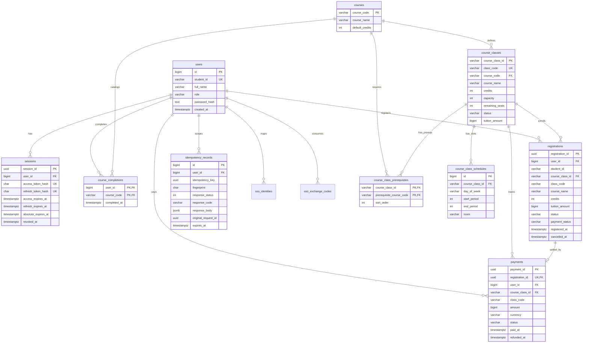

# Thiết kế Cơ sở Dữ liệu PostgreSQL 16 (`database_design.md`)

Tài liệu này mô tả chi tiết lược đồ cơ sở dữ liệu PostgreSQL 16 tại [`001_initial_schema.sql`](file:///d:/Code/Backend-DKHP/backend/migrations/001_initial_schema.sql), lý do lựa chọn cấu trúc bảng, ràng buộc toàn vẹn (constraints), chỉ mục (indexes) và các bất biến liên bảng (cross-table invariants) để bảo vệ đồ án.

---

## 1. Sơ đồ Thực thể – Liên kết (ERD)

---

## 2. Lý do Thiết kế các Nhóm Bảng Trọng tâm

### 2.1. Bảng Quan hệ Chuẩn hóa cho Lịch học (`course_class_schedules`) và Tiên quyết (`course_class_prerequisites`)
Thay vì lưu JSON không cấu trúc trong `course_classes`, hệ thống tách thành hai bảng quan hệ chuẩn hóa:
1. **Ràng buộc khóa ngoại thật (FK)**: `prerequisite_course_code REFERENCES courses(course_code)` bảo đảm 100% ở tầng CSDL không bao giờ gán nhầm mã môn không tồn tại, và `JOIN courses` lấy ngay `course_name` chuẩn xác.
2. **Ràng buộc miền giá trị bằng `CHECK`**: PostgreSQL kiểm tra trực tiếp `day_of_week IN ('MON'..'SUN')`, `start_period BETWEEN 1 AND 12`, `end_period BETWEEN 1 AND 12`, và `start_period <= end_period`.
3. **Truy vấn kiểm tra trùng lịch hiệu quả**: Khi sinh viên đăng ký lớp mới, truy vấn `JOIN registrations r ON ... JOIN course_class_schedules s ON ... WHERE r.user_id = %s AND r.status = 'ACTIVE'` chạy trên chỉ mục `idx_schedules_class_id` trong chưa đầy 1 ms, không cần giải nén mảng JSONB.
4. **Tránh lỗi N+1 khi đọc danh sách**: Trong [`CourseClassRepository.hydrate_course_classes`](file:///d:/Code/Backend-DKHP/backend/app/repositories/course_class_repo.py#L118-L253), toàn bộ lịch học, tiên quyết, học phần hoàn thành và trạng thái đăng ký của 1 trang lớp (tối đa 100 lớp) được tải bằng **đúng 4 câu SQL hằng số** thông qua toán tử `= ANY(%s)`.

### 2.2. Giữ Lịch sử & Snapshot Học phí / Tên lớp trên `registrations` và `payments`
- Bảng `registrations` lưu trực tiếp các cột snapshot tại thời điểm đăng ký: `class_code`, `course_name`, `credits`, `tuition_amount`.
- **Vì sao không `JOIN` sang `course_classes` khi xem lịch sử đăng ký?**
  Nếu sau khi sinh viên đăng ký, quản trị viên đổi `course_name` của lớp (được phép theo Mục 15 của đặc tả), hoặc lớp chưa có ACTIVE được đổi `credits`/`tuition_amount`, bản ghi lịch sử của sinh viên vẫn phải giữ nguyên tên lớp, số tín chỉ và mức học phí đã cam kết lúc đăng ký.
- Hệ thống **không bao giờ xóa cứng (`DELETE`)** bản ghi `registrations` hay `payments` qua API nghiệp vụ:
  - Hủy đăng ký chỉ chuyển `status: ACTIVE -> CANCELLED` và ghi `cancelled_at`.
  - Hoàn tiền mô phỏng chỉ chuyển `payments.status: PAID -> REFUNDED` và `registrations.payment_status: PAID -> REFUNDED` trong cùng giao dịch.
  - Đăng ký lại tạo một `registration_id` (UUID v4) hoàn toàn mới với `payment_status = 'UNPAID'`.

### 2.3. Sinh Mã Lớp Nguyên tử bằng Sequence (`course_class_id_seq`)
- Không bao giờ dùng `SELECT MAX(course_class_id) + 1` vì hai request `POST /admin/course-classes` chạy đồng thời sẽ đọc cùng giá trị `MAX` và gây lỗi trùng khóa chính!
- Thay vào đó, PostgreSQL cấp số nguyên tử qua `SELECT nextval('course_class_id_seq')` -> định dạng `LHP001`…`LHP999999`. Sau khi chạy `scripts.seed`, sequence luôn được đồng bộ bằng `setval(...)` theo hậu tố lớn nhất đang có trong `course_classes`.

---

## 3. Hệ thống Ràng buộc (Constraints) và Chỉ mục (Indexes)

| Ràng buộc / Chỉ mục | Bảng | Vai trò bảo vệ dữ liệu & hiệu năng |
|---|---|---|
| `uq_registrations_active_user_class` (`UNIQUE (user_id, course_class_id) WHERE status = 'ACTIVE'`) | `registrations` | **Chốt chặn quan trọng nhất**: Ngăn tuyệt đối việc một sinh viên có 2 dòng `ACTIVE` trên cùng một lớp, đồng thời vẫn cho phép lưu nhiều dòng `CANCELLED` lịch sử khi hủy rồi đăng ký lại. |
| `chk_course_classes_remaining_seats` (`0 <= remaining_seats <= capacity`) | `course_classes` | Ngăn âm chỗ (`remaining_seats < 0`, oversell) và ngăn hoàn chỗ vượt `capacity` ngay ở tầng engine PostgreSQL. |
| `chk_registrations_state_consistency` | `registrations` | Cấm hoàn toàn trạng thái bất hợp lệ trên cùng một hàng, ví dụ `status = 'CANCELLED'` nhưng `payment_status = 'PAID'` hoặc thiếu `cancelled_at`. |
| `uq_payments_registration_id` (`UNIQUE (registration_id)`) | `payments` | Đảm bảo mỗi lượt đăng ký có tối đa 1 giao dịch thanh toán; không thể thu tiền hai lần cho cùng `registration_id`. |
| `uq_idempotency_user_key` (`UNIQUE (user_id, idempotency_key)`) | `idempotency_records` | Cô lập phạm vi khóa Idempotency theo từng người dùng xuyên suốt mọi API ghi (`register`, `cancel`, `payments`). |
| `uq_sessions_access_hash`, `uq_sessions_refresh_hash` | `sessions` | Tra cứu token băm SHA-256 trong `O(log N)` cho mỗi request xác thực và xoay vòng refresh token. |
| `idx_registrations_user_history`, `idx_registrations_active_class` | `registrations` | Tăng tốc phân trang `/registrations/me` (`ORDER BY registered_at DESC, registration_id ASC`) và đếm nhanh số `ACTIVE` theo lớp. |

---

## 4. Các Bất biến Liên bảng (Cross-Table Invariants) & Cơ chế Bảo vệ

Một ràng buộc `CHECK` đơn lẻ của PostgreSQL chỉ kiểm tra được các cột trong **cùng một hàng**, không thể tự động đảm bảo tổng `COUNT(*)` xuyên bảng. Do đó hệ thống bảo vệ 5 bất biến liên bảng bằng **giao dịch ACID + khóa tường minh (`SELECT ... FOR UPDATE`)** và đối soát hậu kiểm bằng [`check_invariants.py`](file:///d:/Code/Backend-DKHP/backend/scripts/check_invariants.py):

1. **Bảo toàn sĩ số trên mọi lớp (kể cả lớp 0 đăng ký — dùng `LEFT JOIN`)**:
   $$\text{remaining\_seats} + \text{COUNT}(\text{registrations ACTIVE của lớp}) = \text{capacity}$$
2. **Giới hạn chỗ ngồi**:
   $$0 \le \text{COUNT}(\text{ACTIVE}) \le \text{capacity}$$
3. **Không trùng đăng ký đang hiệu lực**: Tối đa 1 bản ghi `ACTIVE` cho mỗi cặp `(user_id, course_class_id)`.
4. **Đồng bộ trạng thái hủy – hoàn tiền**: Không tồn tại bản ghi `registrations.status = 'CANCELLED'` nào có `registrations.payment_status = 'PAID'` hoặc `payments.status = 'PAID'`.
5. **Không trùng lịch học đang hiệu lực**: Không tồn tại hai bản ghi `ACTIVE` khác nhau của cùng một sinh viên có cùng `day_of_week` và $\max(\text{start}_1, \text{start}_2) \le \min(\text{end}_1, \text{end}_2)$.

---

## 5. Cơ chế Migration An toàn qua Nhiều Worker
- Công cụ [`migrations.py`](file:///d:/Code/Backend-DKHP/backend/app/db/migrations.py) lấy khóa tư vấn `SELECT pg_advisory_lock(88022026)` trước khi kiểm tra bảng `schema_migrations(version, filename, checksum, applied_at)`.
- Mỗi file SQL được băm SHA-256 (chuẩn hóa `LF` để khớp giữa Windows và Linux container). Nếu file đã áp dụng bị sửa đổi ngoài ý muốn, công cụ báo lỗi ngay thay vì âm thầm bỏ qua.
- Trong `compose.dev.yml`, container `migrate` chạy xong trước khi container `api` (đa worker) khởi chạy; không bao giờ chạy `CREATE TABLE` trong từng request HTTP.
